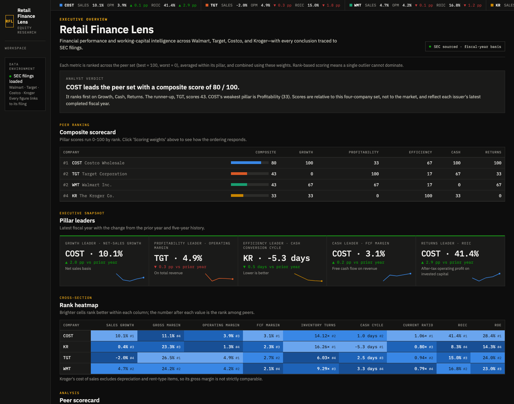

# Retail Finance Lens — Performance & Working Capital Analytics

An auditable financial-analysis portfolio project comparing Walmart, Target, Costco, and Kroger from SEC filings. It answers:

> Which retailers are growing profitably, how efficiently are they managing inventory, and is their profit translating into cash?

**Live dashboard:** <https://retailfinance-analytics.streamlit.app/>

The repository contains the data pipeline, PostgreSQL analytical model, validation checks, seven-page Streamlit dashboard, automated refresh workflow, and evidence-backed report generator.




## Dataset

The dataset is **generated, not bundled**. This prevents an unexplained CSV from becoming the source of truth.

- Source: SEC Submissions and Company Facts APIs plus each filing's primary inline-XBRL document. The filing document supplies audited dimensional revenue breakouts that Company Facts omits.
- Companies: WMT (`0000104169`), TGT (`0000027419`), COST (`0000909832`), KR (`0000056873`).
- Display window: five fiscal periods ending in calendar years 2022–2026 and the latest 12 quarters.
- Support window: earlier annual and quarterly observations remain available for growth rates and average balances.
- Version policy: latest-known facts in analytical views; every as-filed fact retained in the canonical tables.
- Offline development: compact pinned Company Facts fixtures for Walmart, Target, and Costco are under `tests/fixtures`; Kroger's mapping is covered by synthetic-payload unit tests.

Raw responses are kept as gzipped files and as compressed bytes in PostgreSQL with their retrieval timestamp, URL, headers, HTTP status, and SHA-256 hash.

## Quick start with Docker

Prerequisites: Docker Compose and a real contact identity for SEC requests.

```bash
cp .env.example .env
# Edit SEC_USER_AGENT in .env, for example:
# SEC_USER_AGENT="RetailFinanceLens your-name@domain.com"

docker compose up -d db
docker compose --profile pipeline run --rm pipeline
docker compose up -d dashboard
```

Open <http://localhost:8501>.

To generate the findings report after the first load:

```bash
docker compose --profile pipeline run --rm pipeline financial-analysis report --companies all
```

## Local Python workflow

Use Python 3.12 and PostgreSQL 16:

```bash
python3.12 -m venv .venv
source .venv/bin/activate
pip install -r requirements-dev.txt
pip install --no-deps -e .
cp .env.example .env

financial-analysis ingest --companies all
financial-analysis transform --companies all
financial-analysis load --companies all
financial-analysis validate --companies all
financial-analysis report --companies all
streamlit run app/streamlit_app.py
```

Or run the idempotent end-to-end command:

```bash
financial-analysis refresh --companies all --as-of 2026-10-13
```

Each stage is independently rerunnable. Database constraints and upserts prevent duplicate filings and facts.

## Pipeline contract

| Command | Responsibility |
|---|---|
| `ingest` | Download submissions, Company Facts, and filing documents; persist immutable gzip responses and a manifest |
| `transform` | Apply configurable Company Facts and inline-XBRL mappings, classify fiscal periods, and derive standalone flows |
| `load` | Upsert companies, filings, mappings, facts, and compressed source payloads into PostgreSQL |
| `validate` | Record missing-field, accounting-equation, and cash-flow reconciliation results |
| `refresh` | Run ingest → transform → load → validate in one idempotent operation |
| `report` | Generate `reports/v1_findings.md` from the peer analytical view with filing links |

The concept registries are in `config/concepts.yml` and `config/inline_concepts.yml`. Adding an issuer extension or dimensional revenue member is a configuration change with a documented priority, not a hidden code branch.

## Analytical policy

- Net sales drive sales growth and gross margin.
- Total revenue drives operating and net margins.
- Average beginning and ending balances drive inventory, receivable, and payable efficiency.
- Actual fiscal days drive days metrics; 53-week years are flagged.
- Target's and Kroger's years ended January 31, 2026 are issuer FY2025, while Walmart calls its year ended January 31, 2026 FY2026. Both retain their issuer label and align by calendar year of fiscal-period end.
- Missing data remains null. An absent short-term-investment fact, for example, is not silently assumed to be zero in the quick ratio.

See [data dictionary](docs/data_dictionary.md) for all facts and formulas.

## Dashboard

A dark, equity-research-style workspace with a ticker tape (latest sales growth, operating margin and ROIC, with year-over-year change) on every page. Seven pages, each answering one question:

| Page | Question | Contents |
|---|---|---|
| **Overview** | Who leads, and how robust is that? | Trailing-12-month (aligned) or fiscal-year basis, analyst verdict, composite scorecard with adjustable pillar weights, pillar leaders, rank heatmap, ranking robustness |
| **Performance** | How do they compare? | *Growth & margins* (with a five-year range view) · *Working capital* · *Positioning* |
| **Returns** | Are returns good, and why? | *ROIC & DuPont* · *Why returns moved* (incremental ROIC, operating leverage, net-income-to-cash bridge, exact ROE attribution, reinvestment) |
| **Capital & balance sheet** | Where does the cash go, and how strong is the balance sheet? | *Capital allocation* (capex, dividends, buybacks, payout vs FCF) · *Leverage & coverage* (EBITDA, net debt, interest coverage, lease-adjusted ROIC) |
| **Company** | What does one company look like? | *Trends* (annual or quarterly, with filing lineage) · *Statements* (income statement, balance sheet, cash flow, common-size, revenue-to-net-income bridge) |
| **Valuation** | What do the fundamentals support? | Illustrative ten-year DCF with bear/base/bull cases, adjustable assumptions, sensitivity grid and a reverse DCF against a market value you enter |
| **Data quality & methods** | Can I trust it? | Definitions, lineage policy, validation results, fiscal calendars |

**Scoring.** Each metric is ranked across the peer set (best = 100, worst = 0), averaged within six pillars (growth, profitability, efficiency, cash, returns, balance sheet) and combined with weights you can change. A robustness panel re-runs the ranking under named and random weightings and reports how often each company leads. Ranking, not min-max scaling, keeps one outlier from dominating, and a missing metric is excluded rather than scored as zero. Scores are relative to the four companies, not to the market.

The app reads only `analytics.v_annual_metrics`, `analytics.v_quarterly_metrics`, `analytics.v_peer_comparison`, and `analytics.v_data_quality`. Financial formulas do not live in dashboard code.

## Quality controls

```bash
pytest --cov=financial_analysis --cov-report=term-missing
```

Tests cover the issuer mappings (including Kroger's derived net inventory and 16-week first quarter), annual/YTD/standalone-quarter classification, Q4 derivation, 53-week years, normalized capex signs, materiality tolerance, and the SQL metric contract. Integration acceptance additionally requires:

- Idempotent repeated loads.
- Five annual and twelve quarterly displayed periods per company when SEC history supplies the required facts.
- Assets equal liabilities plus equity within the greater of $5 million or 0.01% of assets.
- Cash-flow reconciliation within the same tolerance policy.
- No silent zero-filling and a source accession for every displayed period.

## Project map

```text
src/financial_analysis/  pipeline, SEC client, models, validation, report generator
config/concepts.yml      canonical-to-XBRL concept registry
sql/                     analytical PostgreSQL views
app/                     Streamlit entry point and pages
tests/fixtures/          pinned offline SEC response slices
docs/                    architecture, data dictionary, deployment, troubleshooting
reports/                 generated evidence-backed findings
```

See [architecture](docs/architecture.md), [deployment](docs/deployment.md), and [troubleshooting](docs/troubleshooting.md) for operational details.
The completed source-to-dashboard tie-out is in [manual reconciliation](docs/manual_reconciliation.md).

## Scope boundary

Version 1 is consolidated-company, USD, U.S. GAAP analysis. It excludes segment reporting, valuation, market prices, forecasts, anomaly detection, and ML. The retained filing history and lineage are intentionally designed to support those Version 2 additions later.
