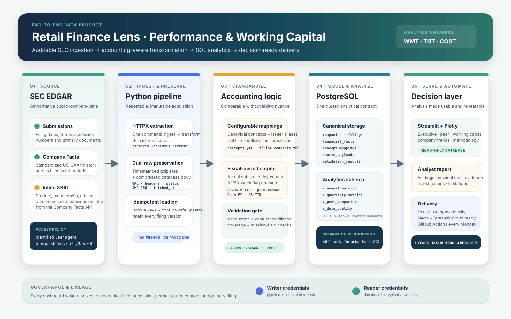

# Architecture

The platform is intentionally divided into five layers:

1. **Source:** SEC submissions, Company Facts, and primary inline-XBRL filing documents.
2. **Ingest and preserve:** an identified, throttled Python client stores immutable gzip files and compressed database payloads with hashes and retrieval metadata.
3. **Standardize and validate:** configurable mappings, fiscal-period logic, standalone-quarter derivation, and accounting checks produce comparable canonical facts without zero-filling missing values.
4. **Model and analyze:** PostgreSQL retains fact versions and exposes a stable analytical contract through four read-only views. SQL owns every financial formula.
5. **Serve and automate:** Streamlit, the analyst report, Docker, and GitHub Actions deliver the analysis using credentials separated by read/write responsibility.

The raw layer is append-only. A SHA-256 hash identifies identical responses, while every distinct response and filing version remains retained. Company Facts provides the broad standardized fact history; filing-document parsing supplies dimensional product, membership, advertising, credit-card, and other-revenue components that the API omits. SQL views prefer those audited inline components, then select the latest-filed version without destroying history.

Derived facts have value-aware version keys. A corrected calculation therefore remains auditable beside the prior calculation, while reported facts from a filing are immutable.

## Boundaries

- Python owns HTTP access, preservation, Company Facts and inline-XBRL mapping, period classification, and loading.
- PostgreSQL owns analytical formulas and latest-version selection.
- Streamlit reads analytical views only and performs presentation formatting, not finance calculations.
- GitHub Actions owns the weekly scheduled refresh. The application and pipeline use separate database credentials.

The editable source for the visual is the repository-native SVG at `docs/assets/architecture.svg`; it requires no proprietary design tool to update.
